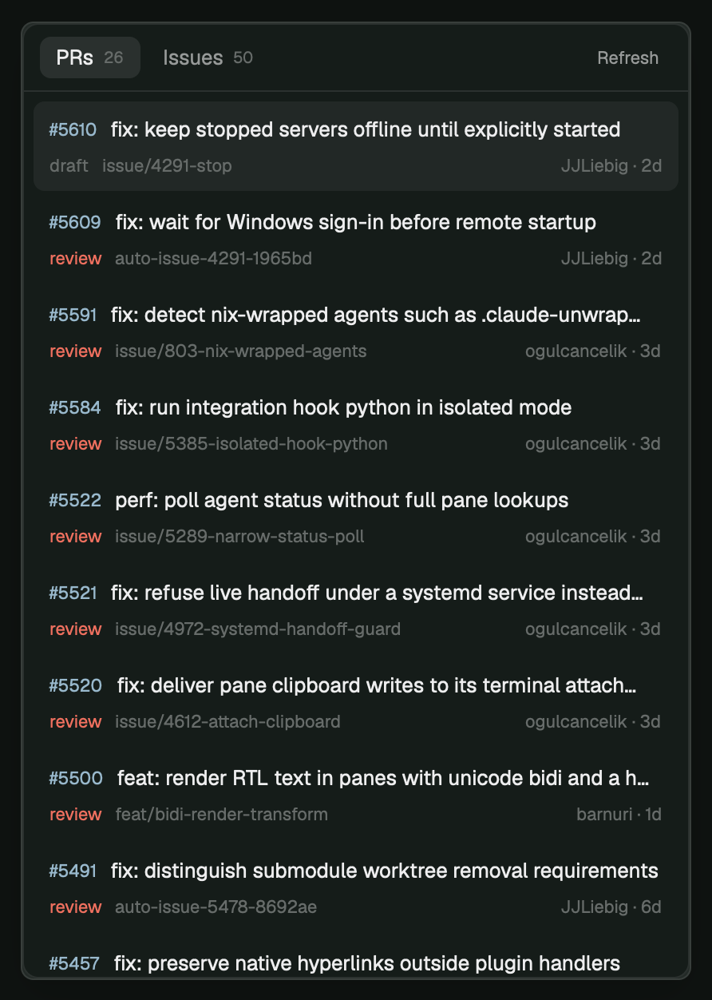
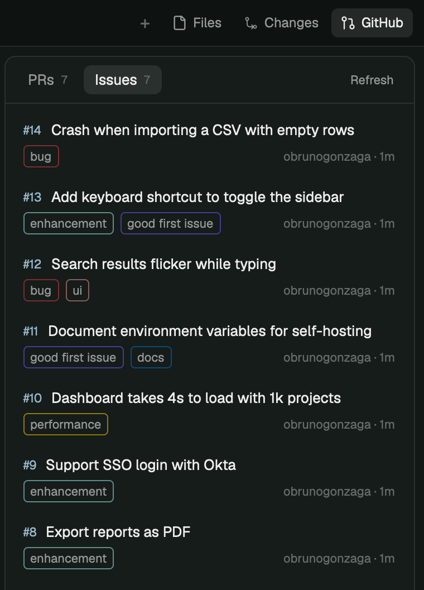
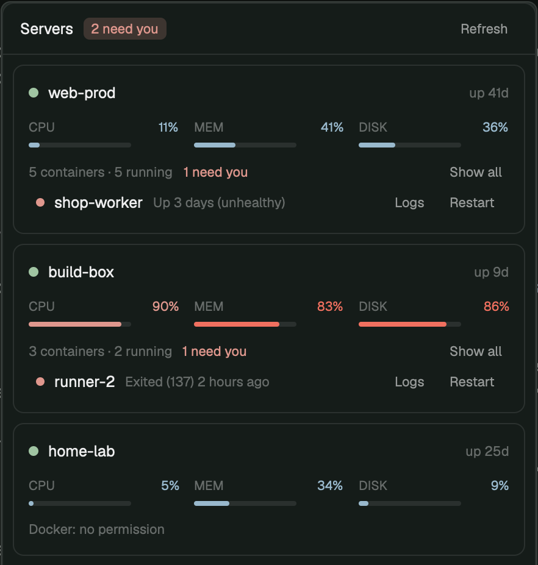
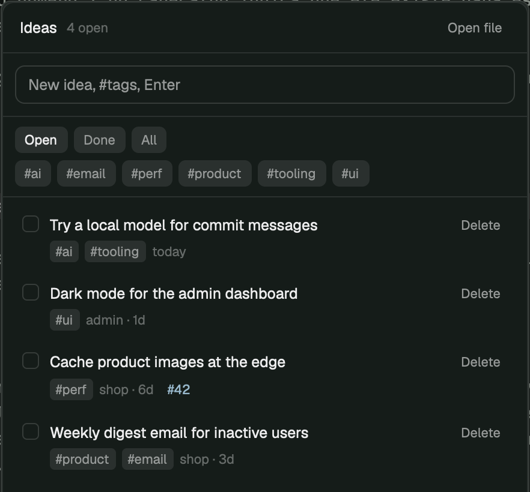

# herdr-mods

Mods for [Herdr](https://github.com/herdrdev/herdr-app), the desktop app for terminals and coding agents.

| Mod | What it does |
| --- | --- |
| [github-panel](github-panel/RECIPE.md) | Open PRs and issues of the space's repo, via `gh`. `cmd-shift-g` opens it. Start any installed agent on an issue, with model and reasoning, in a new worktree. A status-bar CI badge, with a notification when any space's checks finish. |
| [servers-panel](servers-panel/RECIPE.md) | CPU, memory, disk and Docker containers of every machine Herdr reaches. Logs, restart, and a notification when a container goes down. `cmd-shift-m` opens it. |
| [ideas-panel](ideas-panel/RECIPE.md) | An ideas bank in a Markdown file you choose (an Obsidian vault works): capture with `#tags`, filter by repo or tag, tick off, turn into a GitHub issue. `cmd-shift-i` opens it. |

| Popup (`cmd-shift-g`) | Side panel (cloned layout) |
| --- | --- |
|  |  |

| Servers | Ideas |
| --- | --- |
|  |  |

## Install

Ask your agent to add `github.com/obrunogonzaga/herdr-mods/github-panel`, or copy it yourself:

```sh
git clone https://github.com/obrunogonzaga/herdr-mods
cp -R herdr-mods/github-panel/mods/github herdr-mods/github-panel/mods/issue-agent ~/.config/herdr-app/mods/
herdr-app check ~/.config/herdr-app/mods/github
herdr-app check ~/.config/herdr-app/mods/issue-agent
```

Servers: `cp -R herdr-mods/servers-panel/mods/servers ~/.config/herdr-app/mods/`.

Ideas: `cp -R herdr-mods/ideas-panel/mods/ideas ~/.config/herdr-app/mods/`, then point it at your file in `~/.config/herdr-app/ideas.json`: `{ "file": "~/notes/ideas.md" }` (default `~/ideas.md`).

Then merge each item's `keys.json` into `~/.config/herdr-app/keys.json`.

Mods are trusted code: these run `gh`, `git`, `open` and `docker` (on every machine Herdr reaches), restart containers and start agents. Read it before installing.

## Development

Edit here, then run `./sync.sh`. Tests: `node --test`. It copies every item's `mods/` and `layouts/` into `~/.config/herdr-app` (or `$HERDR_APP_HOME`) and runs `herdr-app check` on each mod. Herdr reloads on copy.

Herdr doesn't follow symlinks for live reload, so the repo is copied, not linked.

`personal/` is my own setup (a tab bar with a GitHub button and the layout using it). It has no `RECIPE.md`, so it isn't listed on herdr.dev.
