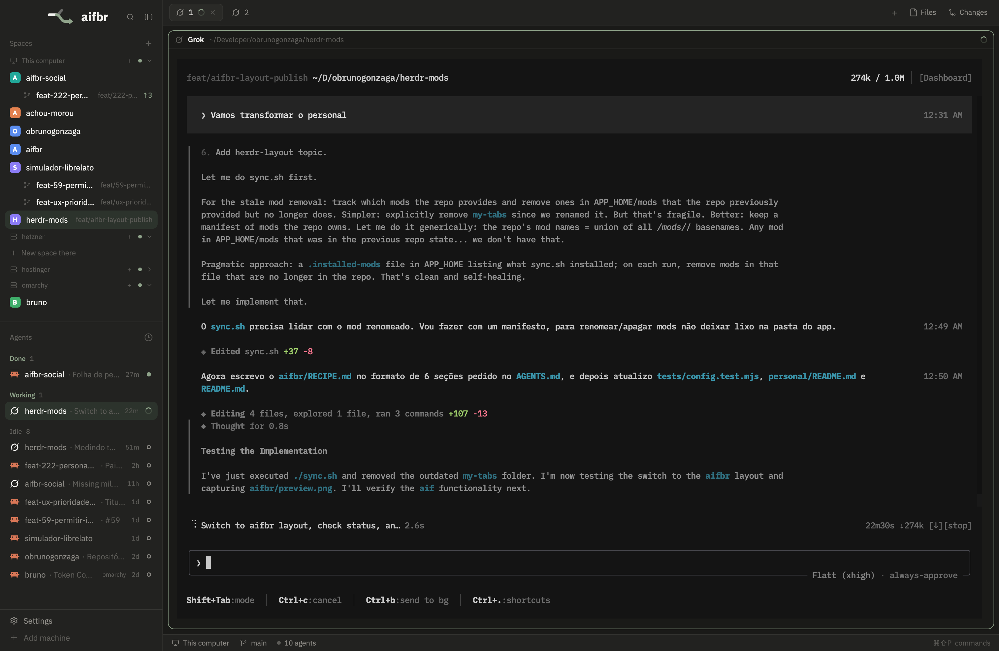

# AIFBR

A calm, muted sage-and-stone workspace layout built over Herdr's `main` window, with an `aifbr` brand header in the left sidebar, light and dark theme pair, IBM Plex typography, framed terminal cards with always-on headers, and a tab bar that reveals panel buttons for every panel in its stack.

## What you see

Two columns filling a borderless window (`titlebar: "none"`, macOS traffic lights at `[12, 16]`):

- **Left sidebar** (`268px` wide, `44px`–`480px` resizable, `chrome` fill):
  - **Brand header**, `56px` tall, `window_drag: true`: `76px` left padding on macOS when expanded to clear the traffic lights, the `aifbr` symbol SVG (`48×31`, dark or light asset matching `settings().dark`) and `aifbr` at `20px` bold `foreground`, then search (`picker`) and sidebar-toggle `26×26` icon buttons on the right. Collapses to a `76px` rail on macOS (`44px` elsewhere) when narrowed below `160px`.
  - **Spaces** and **Agents** lists stacked equally (`min: 90`), using Herdr's shipped `spaces` and `agents` mods.
  - **Footer**, `69px` tall, using Herdr's shipped `workspace-chrome` mod with `{ footer: true }` (`Settings` with update dot, `Add machine`).
- **Right work column** (`resizable: false`, `canvas` background):
  - **Tab bar** (`42px` tall, `window_drag: true`, `1px` `border` underneath): scrollable pill tabs (`29px` tall, `radius: 7`, `1px` `border` when active on `raised`, `working` spinner, `blocked`/`done` `6px` dot, close button on active), a `+` button (`new-menu`), panel buttons (`26px` tall, `radius: 6`, `selected` fill when open), and window controls where the OS draws none.
  - **Work body** (`8px` padding and gap):
    - **Terminal area** (`tab: "active"`): every pane — including a lone pane (`lone: true`) — is a `radius: 10` card on `background` with `1px` `border` (`accent` when focused), `8px` gap between splits, `[14, 12]` terminal padding, and an always-visible `30px` top `pane` header.
    - **Side panel** (`368px` wide, `280px`–`900px`, hidden by default): a `stack` holding `files` and `changes`. Any extra panel added to `panel-body` (`github`, `servers`, `ideas`) gets its button in the tab bar automatically.
  - **Status bar** (`28px` tall, `resizable: false`): Herdr's shipped `workspace-status` mod.

**Typography and colors:** `IBM Plex Mono` weight `500` for terminals and `IBM Plex Sans` for UI (`14` `.ttf` files per face bundled under `mods/aifbr-chrome/fonts/`, SIL OFL). Switches automatically between `aifbr-light` (`#f7f6f3` canvas, `#1e1e1c` ink, `#5f7560` sage accent) and `aifbr-dark` (`#1a1a18` canvas, `#f4f3f0` ink, `#8fa38a` sage accent).

## How it behaves

- Clicking any sidebar brand/toggle/search button stops mouse-down propagation so `window_drag` never hijacks clicks; dragging empty areas of the brand header or tab bar moves the window, double-clicking maximizes it.
- Narrowing `sidebar` below `160px` (by dragging or clicking the collapse button) switches the brand header to the compact rail and saves the prior width in `shared("sidebar.width")`.
- Double-clicking a tab renames it (`tab.rename`); dragging one over another reorders (`tab.move`); wheel scrolling over the tab strip cycles tabs (`tab.prev` / `tab.next`); right-clicking opens `menu`.
- Side panel choice (`files`, `changes`, or closed) is remembered per space in `aifbr-tabs`'s `localStorage` and restored when switching spaces.
- `aifbr-tabs` reads `layout()`'s `panel-body` children on every render: `files` and `changes` follow `shared("workspace.panels")`, and optional panels (`github`, `servers`, `ideas`) get a tab-bar button as soon as their block exists in `panel-body`.

## Built from

- **`layouts/aifbr.json`**: cloned from `main` (`0.1.8`), setting `theme: { light: "aifbr-light", dark: "aifbr-dark" }`, `font: "IBM Plex Mono"`, `font_weight: 500`, `ui_font: "IBM Plex Sans"`, `terminal_padding: [14, 12]`, `titlebar: "none"`, `traffic_lights: [12, 16]`, and referencing `aifbr-chrome` in `brand` and `aifbr-tabs` in `tabs`.
- **`mods/aifbr-chrome/`**: cloned from `workspace-chrome` (`0.1.16`). Swaps the brand icon/title for `simbolo-escuro.svg` / `simbolo-claro.svg` (`48×31`) + `aifbr` (`20px` bold) and bundles `IBM Plex Mono` and `IBM Plex Sans` under `fonts/`.
- **`mods/aifbr-tabs/`**: cloned from `tabs` (`0.1.8`). Derives panel buttons dynamically from `panel-body`'s children in `layout()`, with `github.svg`, `lightbulb.svg`, and `LICENSE-Lucide.txt` self-contained inside the mod folder.
- **`themes/aifbr-dark.json`** and **`themes/aifbr-light.json`**: full theme definitions (`background`, `foreground`, `selection`, `cursor`, `ansi[0..15]`, and semantic `colors`).
- **Shipped mods used**: `spaces`, `agents`, `workspace-chrome` (for the footer), `new-menu`, `menu`, `pane`, `files`, `changes`, `workspace-status`, `picker`, `machine-add`.
- **External access**: none. No `exec`, `hc`, `fetch`, or file writes outside mod-local `localStorage` and `shared("sidebar.*")`.

## Watch out

- `aifbr-chrome` and `aifbr-tabs` depend on a few SVGs from Herdr's shipped `workspace-chrome` (`spinner.svg`, `server.svg`, `settings.svg`, `plus.svg`) and `pane` (`close.svg`) mods, plus `files/file.svg` and `changes/changes.svg`. Those ship with Herdr; on a stripped-down install, copy them locally or swap for files in the mod folder.
- Only the `Regular` / `Medium` / `Bold` faces are needed if trimming bundle size; the `14` `.ttf` files in `mods/aifbr-chrome/fonts/` cover regular, medium, semibold, bold and italics for both IBM Plex families.
- `layouts/aifbr.json` references only `files` and `changes` in `panel-body` so the layout loads without extra mods. To include the companion `github`, `servers`, and `ideas` panels (from this same repo) and the CI status badge, install those mods first and add their blocks to `panel-body` and `status`.
- `aifbr-chrome` renders the `aifbr` brand mark; swap `simbolo-escuro.svg`, `simbolo-claro.svg`, and the `"aifbr"` text string in `mods/aifbr-chrome/main.js` to rebrand.

## Done when

- `herdr-app check mods/aifbr-chrome` and `herdr-app check mods/aifbr-tabs` both pass.
- Switching to `aifbr` (`ctrl-shift-l`) loads without errors in `herdr-app status`, renders `IBM Plex Mono` / `IBM Plex Sans`, and adapts to both light and dark appearance.
- Every terminal pane has a `1px` border (`accent` when focused), `10px` radius, and an always-visible `30px` header.
- Narrowing the sidebar below `160px` switches the brand header to the compact rail and leaves room for the macOS traffic lights; clicking the toggle button restores the previous width.
- Clicking `Files` or `Changes` in the tab bar opens the side panel, and switching spaces remembers whether the panel was open on each space.
