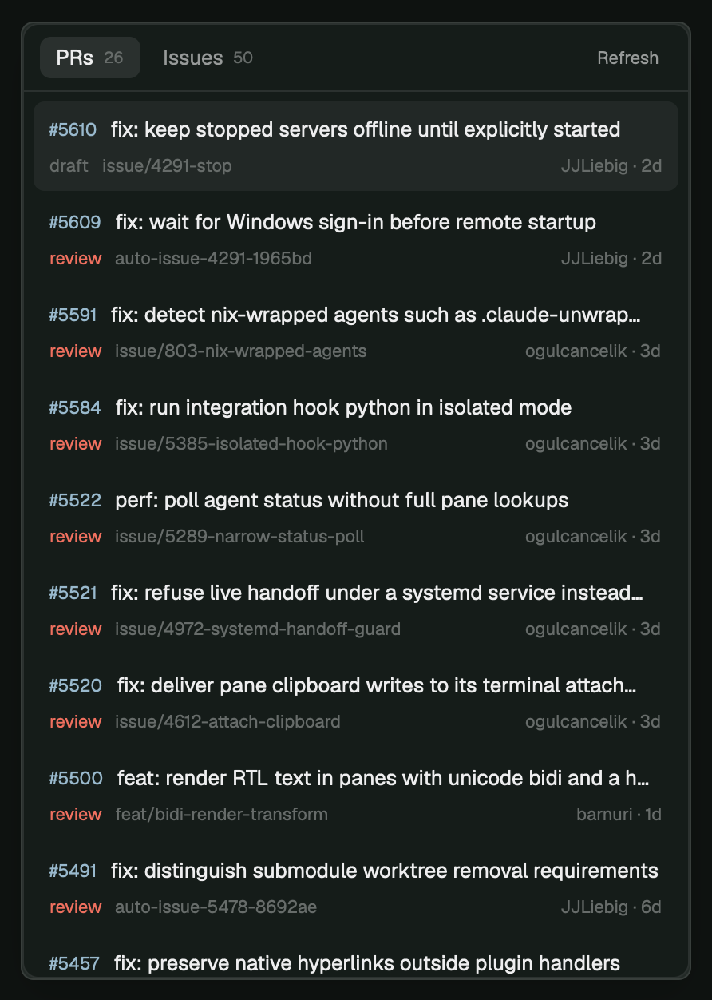

# GitHub

The open pull requests and issues of the repo you are looking at, in one panel. Two tabs switch
between PRs and Issues; each row shows the number, the title, who opened it and how long ago it
was last updated. PRs also show their review state and branch; issues show their labels. Click a
row and the panel shows that PR or issue: its description, status and, for a PR, each check. A
`GitHub` button, or a command-click on the row, still opens it in the browser. Each issue has an `Agent` button: pick an installed agent, a model and a
reasoning level, and it starts on the issue in a new worktree. It opens as a popup over the window (`cmd-shift-g`), and fits a
side panel of a cloned layout just as well. The same mod also draws a CI badge for a status bar: the
checks of the shown space's PR, and a notification when any space's checks finish.

## What you see

One column on the `background` color, radius 10, a 1px `border`, base type 13px. Top to bottom:

- **Header**, 42px tall, 10px side padding, a 1px `border` line under it. On the left two tab
  buttons, 4px apart, each 26px tall, 10px side padding, radius 7: the label (`PRs`, `Issues`)
  and its count at 10px in `dim`. The chosen one is `foreground` on `selected`; the other is
  `muted`. Both get `hover` under the pointer. On the right a `Refresh` button, 11px `muted`,
  26px tall, radius 7; while a load runs it reads `…`.
- **Filter bar**, 38px tall, 8px side padding, 6px gaps, a 1px `border` line under it. A sort chip
  (`Newest ↕`, `Oldest ↕`, `Updated ↕`, and `Milestone ↕` once the repo has an open
  milestone), a `Labels` chip (`Labels · 2` with two picked), a search
  field filling the rest (24px, radius 6, placeholder `Search, then Enter`, its border `accent`
  while a search applies) and, when anything differs from the default, `Clear`. Chips are 24px,
  8px side padding, radius 6, 11px; active ones `selected`/`foreground`, others `raised`/`muted`.
- **Label picker**, under the bar while `Labels` is open: the repo's labels as 20px pills wrapping,
  up to 132px tall then scrolling; each has a 1px border in its GitHub color (53% alpha when off),
  and when picked a 27% fill of that color and `foreground` text.
- **The list**, scrolling, 6px padding, rows 2px apart. Each row is two lines on a radius 7
  card, 10px side and 7px vertical padding, 3px between lines, `hover` under the pointer:
  - Line one: `#5610` at 11px in `accent`, an 8px gap, then the title in `foreground`,
    truncated to the width. Issues end it with an `Agent` button: 20px tall, 7px side padding,
    radius 6, 11px `muted`, a 1px `border`; `raised` and `foreground` under the pointer.
  - Line two, 11px `dim`: on the left, for a PR, its CI (`✓` in `ansi2`, `✗` in `ansi1`, `●` in
    `working`, nothing without checks), its review state, then its branch, 8px apart
    (`draft` in `dim`, `approved` in `ansi2`, `changes` in `ansi1`, otherwise `review` in
    `blocked`); for an issue, up to three labels, each a pill with 5px side padding, radius 4,
    a 1px border in the label's own GitHub color at 53% alpha and text in `muted`. A label
    already picked in the filter is left off this line. On a flat issue list, the milestone
    title comes first, in `muted`, and then at most two labels. On the
    right: `author · 2d` (`m`, `h` or `d` since it was opened, or since its last update when
    sorted by `Updated`).
- **Milestone groups**, in place of the flat issue list while the sort chip says `Milestone`.
  One 28px header per milestone that has a matching issue, radius 7, `hover` under the pointer:
  `▾` or `▸` at 11px `muted`, the title at 12px semibold, and on the right `3 open · 5 closed ·
  due 6d` at 11px `dim` (`Nd overdue` when the due date has passed, `due today` on the day).
  The counts are the milestone's own open and closed numbers. A click collapses that section.
  Milestones with a due date come first, soonest first; the rest follow by title. `No milestone`
  is last, starts collapsed, and its meta is only `N open`. Issues inside a section stay in
  newest-created order. The milestone name is not repeated on those rows.
- In place of the list, at 8px padding: `Loading…` before the first load; `No open pull
  requests` or `No open issues` when empty; `Not a git repository`, `No GitHub remote in this
  repo`, `Run gh auth login first` or gh's first error line in `ansi1` when it fails.

**The detail** replaces the tabs, filters and list in the same frame:

- **Toolbar**, 42px, 10px side padding, a 1px `border` under it. `Back`, `GitHub` and `Refresh`
  are 26px chips, 8px side padding, radius 7, 11px `muted`, `hover` under the pointer. `Refresh`
  reads `…` while a load runs. Between `Back` and the buttons, `#5610` at 11px `dim`, truncated.
  An issue also has the list's `Agent` button. `GitHub` appears once the item has loaded.
- **Summary**, 10px side padding, 8px vertical, 6px between lines, a 1px `border` under it. The
  title at 14px semibold, wrapping. Then `author · opened 2d · updated 5h` at 11px `dim`, plus
  `closed` when it is no longer open. A PR then shows its review state, `branch → base` (truncated),
  `+N` in `ansi2`, `-N` in `ansi1`, `N files`, and a merge word when it is not the same word as the
  review state: `clean` in `ansi2`; `dirty`, `blocked` and `unstable` in `ansi1`; `behind` in
  `blocked`; `draft`, `hooks` and `unknown` in `dim`. Then the CI line, the same words as the
  badge, and each check on a 22px row: `✓`, `✗` or `●` and its name. That list scrolls after
  132px. A check whose details URL is https opens it. An issue shows every label, as on the list,
  and `assignees ada, grace` at 11px `dim`. An issue with a milestone shows its title there
  too, at 11px `dim`, above the labels.
- **Description**, filling the rest, scrolling, 10px side padding. The body as markdown.
  `No description` in `dim` when the body is empty. A link in the body opens only when it is https.
- Before the first payload, `Loading…` in `dim`. When that load fails, gh's first error line in
  `ansi1`. A later refresh that fails keeps the payload and shows the error under the summary.

As a popup it is 420×600 px, centered.

**The CI badge** (`{ "mod": "github", "props": { "view": "ci" } }`, 28px tall): the `chrome`
background with a 1px `border` on top, 14px side padding, 11.8px type, right-aligned. For the shown
space's PR: `#5609  CI ✓ passed` in `ansi2`; `#5609  CI ✗ 2 failed` in `ansi1`; while running, the
shipped `mods/workspace-chrome/spinner.svg` at 12px turning every 900 ms and `#5609  CI 6/10`
(passed of total) in `working`; `CI · no checks` in `dim`. Empty when the branch has no PR.

**The agent dialog** (480×620, `popover` background, 16px padding, sections 14px apart, each
titled in 11px `dim`):

- `Start an agent on #12` at 14px semibold, the issue title under it in `dim`.
- **Branch**: a 30px input, radius 8, prefilled `<type>/<number>-<first five title words>`; the type
  comes from the labels (`bug` → `fix`, `documentation`/`docs` → `docs`, `refactor`, `chore`,
  else `feat`).
- **Agent**: a wrapping row of 26px chips, radius 7, one per installed agent with its icon at
  14px; the chosen one `selected`/`foreground`, the others `raised`/`muted`.
- **Model** (only for agents it knows): a filter input, then a 170px scrolling list. First row
  `Agent's default`, which reads `Use "<typed text>"` when the filter matches no model; then each
  model as `Label  ·  id`, up to 100. `Loading models…` while the CLI answers; its first error line
  in `ansi1` when it fails.
- **Reasoning**: chips of the levels the chosen model supports; `Agent's default` when none is
  chosen, `This model has no reasoning levels` when it has none.
- Footer: the error in 11px `ansi1` on the left, `Cancel` and a `Start agent` button in `solid`
  (`Starting…` while it works).

## How it behaves

- It doesn't show agent statuses: it lists GitHub items, not agents. Nothing animates.
- The repo is the focused pane's folder (else the focused terminal's, else the shown space's
  folder), on that space's machine. Switching space or focus re-renders and reloads at once.
- PRs and issues load together, up to 50 of each, open only. The list reloads every 60 s and
  on `Refresh`. `Milestone` is the exception: each open milestone is loaded on its own, up to 100
  issues, plus the issues with no milestone, so one newest-50 cut cannot split a plan.
- Sorting and filtering happen on GitHub, not on the loaded rows, so `Oldest` reaches issues past
  the newest 50: `--search "sort:<created-desc|created-asc|updated-desc> <text>"` plus one `--label`
  per picked label (an item must have all of them). The sort chip cycles `Newest`, `Oldest`,
  `Updated`, then `Milestone` when the repo has an open milestone. On the PRs tab the cycle stays
  the first three, and a `Milestone` choice still lists PRs as newest. A label click toggles it;
  Enter in the field applies the text and emptying it clears it; `Clear` resets all three. Each
  change reloads at once; an older load that finishes late is dropped. `Milestone` asks
  `gh api repos/<owner>/<repo>/milestones` for the open plans, then one `gh issue list` per plan
  (`--milestone`) and one with `no:milestone` in the search. Inside a plan the order is newest
  created. A milestone with no issue matching the filters is left out. Switching repo collapses
  `No milestone` again and expands the rest.
- Filters apply to both tabs and last while the panel is open. Switching to another repo drops the
  label picks and loads that repo's labels (`gh label list --limit 200`).
- A click on a row opens its detail in the panel. Command-click runs `open <url>` on this computer,
  so the browser opens even for a space on a remote machine. `GitHub` on the detail does the same,
  and so does a check whose details URL is https. `Back` returns to the list with the same tab and
  filters. Switching to another repo, or `github.prs` / `github.issues`, closes the detail.
- The detail loads with `gh pr view` or `gh issue view` for that number, in the folder it was
  opened from. The panel's 60 s reload and `Refresh` on the detail load it again without clearing
  it. An older load that finishes late is dropped. A link in the description goes through `safeUrl`
  before `open`.
- The tab choice is not saved.
- The CI badge looks up every space, not only the shown one: one `gh pr view --json
  number,title,url,statusCheckRollup` per distinct folder and machine (a space's first terminal's
  live folder, else its folder), so agents' worktrees are covered. Every 30 s while any check runs,
  else every 90 s. A failed check (any conclusion but success, neutral or skipped; a status that
  isn't success or pending) wins over checks still running.
- When checks it saw running finish, it notifies once: `CI failed · #12` (level error, the space
  and up to three failed check names; clicking it runs `space.select` on that space) or `CI passed ·
  #12` (success, 6 s). Nothing is notified for checks already done when it first looks.
- A click on the badge opens the first failed check, else the PR's checks page.
- Every link goes through `safeUrl` (`urls.js`) before `open -- <url>` (`open.js`): only `https:`
  passes. A check's details URL is set by whoever runs that CI, so a failed check whose link isn't
  https opens the PR's checks page instead; other links do nothing.
- `Agent` opens the dialog without opening the browser. In it, Enter in the branch field starts.
  Start makes a worktree at `~/.herdr/worktrees/<repo>/<branch, slashes as dashes>` on the space's
  machine (Herdr's own worktree path, so the spaces sidebar nests it and Herdr's worktree dialog
  can remove it), branching from `origin/<default branch>` after a fetch, or from `HEAD` without a
  remote; an existing branch is checked out instead. Then `space.new` opens it with a tab named
  `#12`, `argv` the agent's command plus its model and reasoning flags, and `task` one line asking
  it to read the issue with `gh`, follow AGENTS.md/CLAUDE.md, run lint, typecheck and tests, push
  and open a PR with `Closes #12`, and not merge or deploy. The new space is shown.
- The dialog remembers the last agent, model and reasoning (shared `issue-agent.last`) and caches
  each machine's model lists for an hour (shared `issue-agent.models`).
- Commands: `github.prs` and `github.issues` switch the tab, `github.refresh` reloads,
  `github.sort` cycles the sort, `github.labels` opens or closes the label picker. Bind them in `keys.json` (for example `"cmd-shift-i": "github.issues"`) or run them with `herdr-app do github.issues`. They reach shown copies only.

## Built from

- `mods/github/main.js`: one `View`, default export. `mod.json`:
  `{ "place": "none", "title": "GitHub", "overlay": { "width": 420, "height": 600 } }`, so
  `mod.open {name: "github"}` shows it as a popup and no layout docks it. `github.svg`: a 24×24
  pull-request glyph (two circles joined by a bent line), stroked `currentColor`, for a tab-bar
  button in a cloned layout.
- `mods/github/main.js` picks the view from `props().view` (the first `init` argument doesn't carry
  layout props): `panel.js` (the list, a plain class) or `ci.js` (the badge). Both import
  `checks.js` (`summarizeChecks`, `checksSummaryText`, `finishedState`, `checksIcon`) and `open.js`: a mod can't import another mod's
  files, so one mod with two views shares them. The PR list adds `statusCheckRollup` to its fields.
  `detail.js` is the detail the panel shows in place of the list. `format.js` is the review, merge,
  diff and date words. `gh.js` runs `gh` and maps its errors. The description is `TextView.markdown`.
- `mods/issue-agent/main.js`: the dialog, a `View` opened with `openOverlay({ mod: "issue-agent",
  kind: "dialog", width: 480, height: 620, props: { issue: { number, title, labels }, cwd, on } })`.
  `mod.json`: `{ "place": "none" }`. Uses `knownAgents({ on })` (installed only), `exec` for git and
  `gh repo view`, `home`, `shared`/`setShared`, `run("space.new", { folder, machine, tab, argv, task })`.
- `mods/issue-agent/agents.js`: one adapter per CLI, matched by the agent's key or program:
  | Agent | Models from | Flags |
  | --- | --- | --- |
  | Claude Code | `fable`, `opus`, `sonnet`, `haiku` | `--model`, `--effort` (low…max) |
  | Codex | `codex debug models` (JSON; `visibility: "list"`, per-model reasoning levels and default) | `-m`, `-c model_reasoning_effort=` |
  | OpenCode | `opencode models` (`provider/model` lines) | `--model` |
  | Cursor | `cursor-agent --list-models` (`id - Label` lines) | `--model` |
  | Pi | `pi --list-models` (table; thinking column `yes` gets off…max) | `--model`, `--thinking` |
  | Gemini | none: type one | `--model` |
  Other agents start with their own `run` and no model choice. A CLI that's a shell function is
  retried through `"$SHELL" -ic`.
- `keys.json`: `{ "global": { "cmd-shift-g": "mod.open:github" } }`.
- `herdr` functions: `spaces`, `panes`, `focused` (to find the folder and machine), `exec`,
  `theme`, `nextCommand` (a loop started in `init` that reads `prs`, `issues` and `refresh`).
- Programs: `gh pr list --state open --limit 50 --json
  number,title,author,url,isDraft,createdAt,updatedAt,reviewDecision,headRefName,labels,statusCheckRollup`
  and `gh issue list --state open --limit 50 --json number,title,author,url,labels,createdAt,updatedAt,milestone`,
  plus `gh pr view <n> --json` (body, base, merge, diff, checks, assignees) and
  `gh issue view <n> --json` (body, labels, assignees, milestone), run in the folder
  with `exec(..., { cwd, on })`; `open <url>` locally.
- Reaches the network through `gh` and `git fetch`, runs programs and starts agents with a task.
  Writes worktrees under `~/.herdr/worktrees`. Reads nothing outside its own folder.

## Watch out

- `gh` must be installed and logged in (`gh auth login`) on the machine the space lives on.
  For a remote space it runs there, not here.
- `open` is macOS. On Linux the click does nothing; swap it for `xdg-open`.
- `task` is typed into the agent as one line: a newline would send it early.
- Agents run with whatever permissions their own config gives them; the task tells them to push
  and open a PR.
- Only the first 50 of each list show; the counts in the tabs are of what loaded, not the
  repo's totals.
- Results are dropped when the folder changes mid-load, so a slow `gh` never paints the wrong
  repo.
- To show the badge, clone `main` and turn its `status` block into a row:
  `{ "id": "status", "type": "row", "size": { "px": 28 }, "resizable": false, "children": [ { "id":
  "status-main", "type": "block", "content": { "mod": "workspace-status" } }, { "id": "status-ci",
  "type": "block", "size": { "px": 240 }, "content": { "mod": "github", "props": { "view": "ci" } } } ] }`.
  Notifications only come while the badge is in the shown layout.
- `gh pr view` per space each poll: many spaces mean many API calls.
- To dock it as a side panel, clone `main` and `tabs`, add `{ "id": "github", "type": "block",
  "content": { "mod": "github" } }` to the `panel-body` stack and a third panel button beside
  Files and Changes. The shipped layout and tab bar are replaced on every start.

## Done when

- `herdr-app check mods/github` passes.
- `cmd-shift-g` in a space inside a GitHub repo opens the popup with open PRs listed and the
  counts in both tabs.
- Clicking a row shows that PR or issue's description in the panel. `Back` returns to the same list.
- Command-click on a row, and `GitHub` on the detail, open it in the browser.
- A PR detail lists each check. A check with an https details URL opens it.
- Switching to a space that isn't a repo shows `Not a git repository`.
- `herdr-app do github.issues` with the panel shown switches it to the Issues tab.
- In a space on a PR's branch, the badge shows that PR's number and its checks; PR rows show `✓`/`✗`/`●`.
- `node --test` passes (`summarizeChecks`, `checksSummaryText`, `finishedState`, `safeUrl`, review, merge and diff words).
- `github.sort` once on a large repo shows its oldest open issues first, months old.
- `github.labels` shows the repo's labels in their colors.
- `herdr-app check mods/issue-agent` passes (it renders a placeholder without props).
- `Agent` on an issue, Claude Code, `haiku`, `low`, Start: a new space opens on
  `~/.herdr/worktrees/<repo>/feat-<n>-…`, Claude shows `Haiku … with low effort`, and the task is
  its first message.
